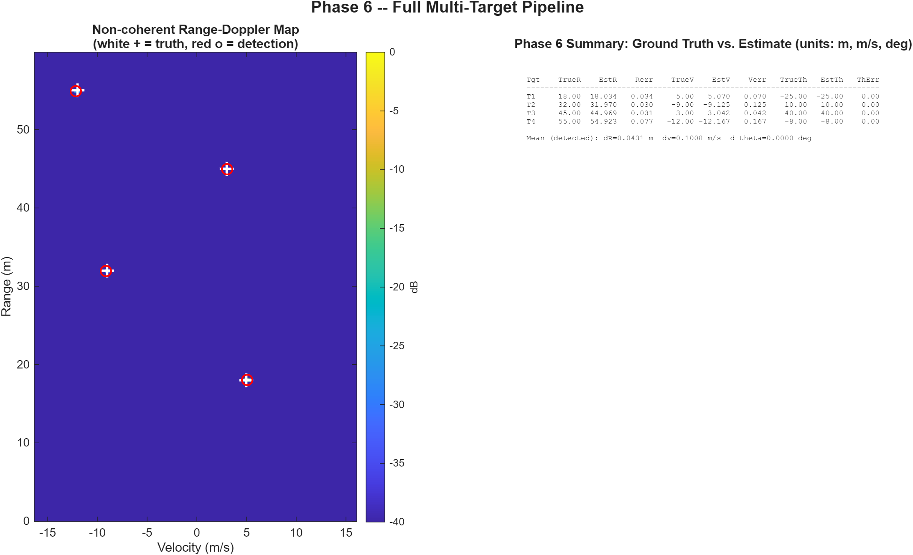
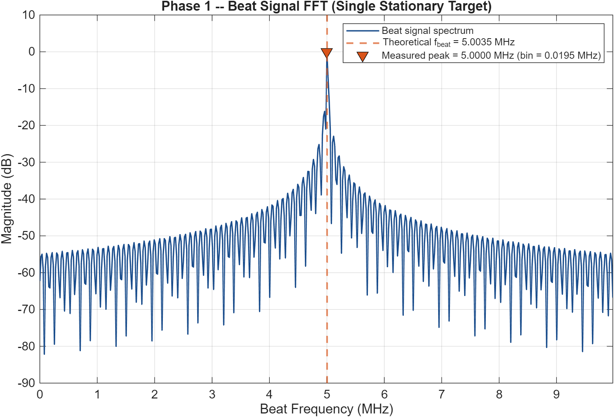
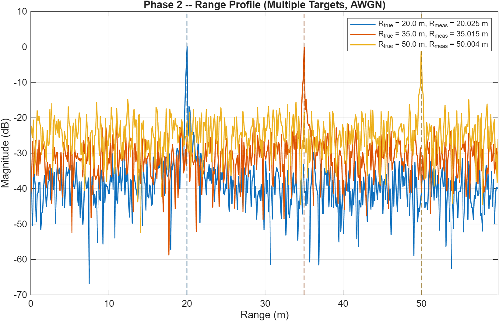
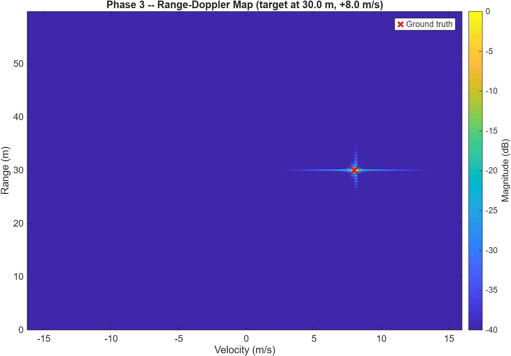
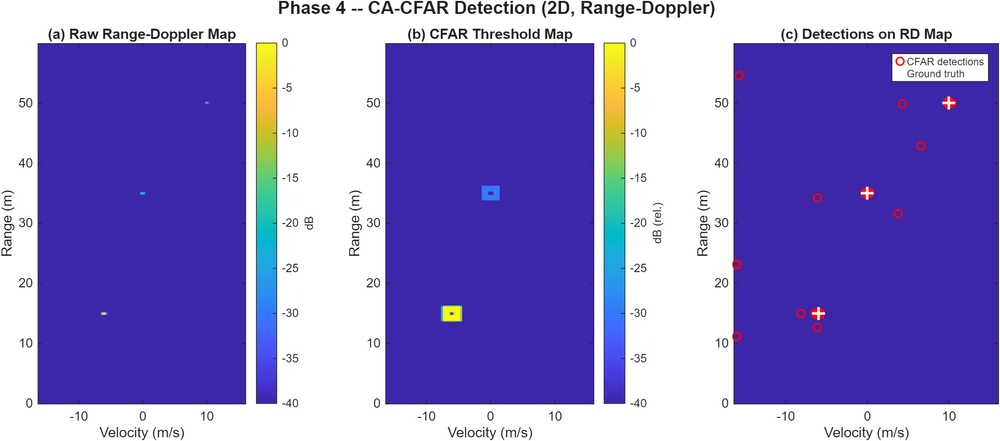
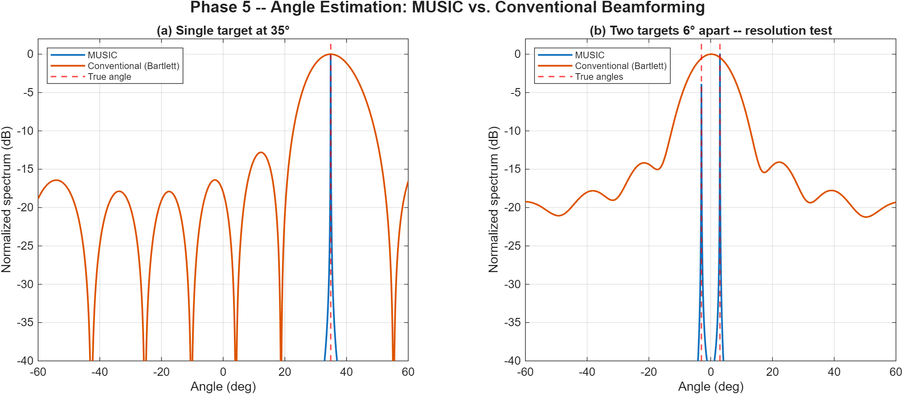
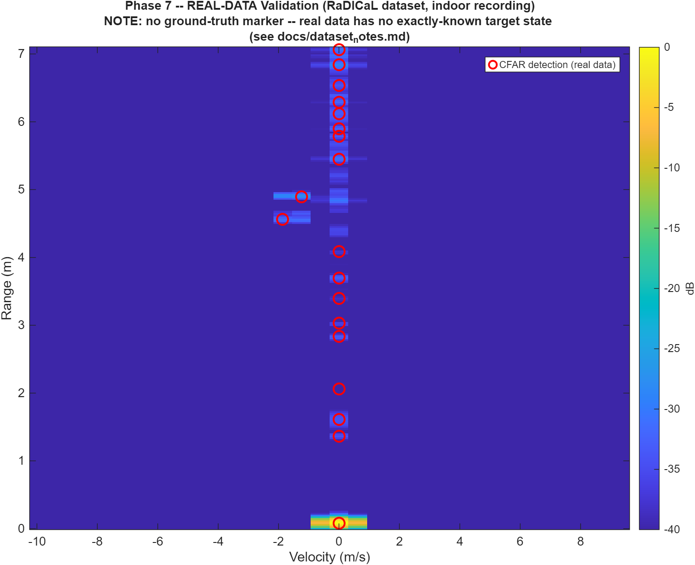
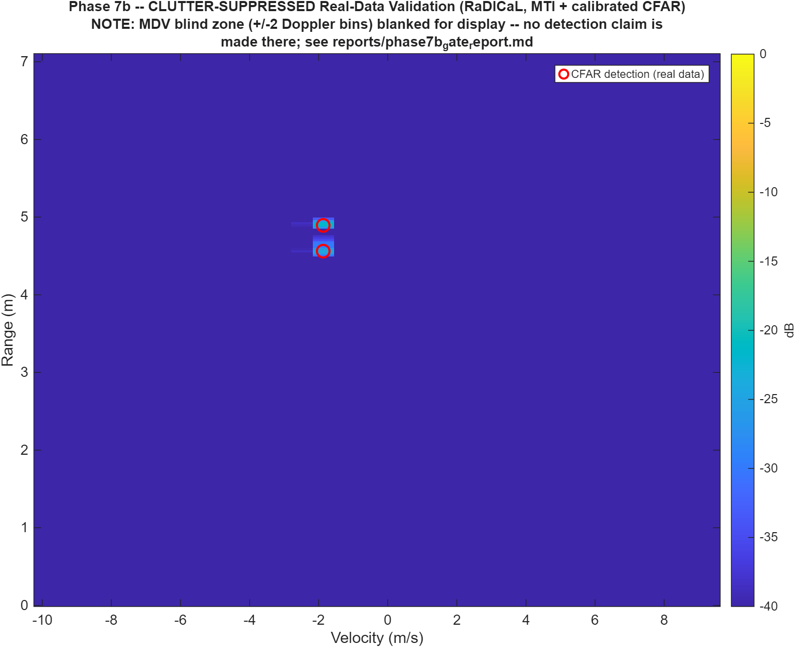

# FMCW Radar Signal Processing in MATLAB

A complete FMCW (frequency-modulated continuous wave) radar processing chain written from first
principles in MATLAB: chirp and echo modelling, range FFT, Doppler processing, range-Doppler
maps, CA-CFAR detection, MUSIC and conventional angle estimation, and multi-target integration.
The pipeline is also run on real recorded radar data from the public RaDICaL dataset.

Each stage is checked against its closed-form theoretical value, and each phase has its own
test script.



## Pipeline

```
FMCW chirp and echo model             (Phase 1)
  -> range FFT                        (Phase 2)
    -> Doppler FFT, range-Doppler map (Phase 3)
      -> 2-D CA-CFAR detection        (Phase 4)
        -> MUSIC angle estimation     (Phase 5)
          -> multi-target integration (Phase 6)
            -> real-data validation   (Phase 7, 7b)
```

Each processing step is a reusable function in `functions/`. The scripts in `src/` call these
functions in order for each phase, so later phases use the same code as earlier ones.

## What is implemented

- FMCW sawtooth-chirp signal model in complex baseband: carrier, sweep, round-trip delay,
  attenuation, dechirp mixing, AWGN
- Range FFT with windowing, range conversion and a two-target range-resolution test
- Slow-time Doppler FFT and range-Doppler maps for stationary, approaching and receding targets
- 1-D and 2-D cell-averaging CFAR, with an empirical false-alarm-rate check against the design
  value, and examples of clutter-edge and target-masking behaviour
- Uniform linear array model with MUSIC (covariance, eigendecomposition, noise subspace) and
  conventional (Bartlett) beamforming, including a case where MUSIC resolves two targets that
  conventional beamforming cannot
- Four-target scenario with different ranges, velocities and angles, with estimated values
  compared against ground truth
- Processing of a real FMCW radar recording (RaDICaL), plus an MTI clutter-cancellation stage
  and calibrated CFAR threshold (Phase 7b)

Steering vectors, covariance estimation and MUSIC are written out by hand rather than called
from a toolbox, so the algorithm is visible in the code.

## Results

| Phase | Result |
|---|---|
| 1. Signal model | Beat frequency: 5.003 MHz theoretical vs. 5.000 MHz measured (0.18 FFT bin) |
| 2. Range processing | 3 targets, maximum range error 0.025 m (less than one range bin); targets 1 resolution cell apart resolved |
| 3. Range-Doppler | Range error 0.021 m, velocity error 0.11 m/s, correct sign for ±8 m/s |
| 4. CFAR detection | All targets detected; measured false-alarm rate matches the design value over four decades |
| 5. Angle estimation | Single-target error ≤ 0.03°; MUSIC resolves two targets 6° apart, conventional beamforming does not |
| 6. Multi-target integration | 4/4 targets detected; mean errors 0.043 m (range), 0.10 m/s (velocity), 0.00° (angle) |
| 7. Real data (RaDICaL) | Resolution and ambiguity limits match the radar's hardware parameters; detections identified as antenna leakage, static clutter at zero Doppler, and two detections from a likely moving target |
| 7b. Real data with MTI | Raw CFAR detections reduced from 93 to 6 (clustered: 19 to 2); leakage and static clutter suppressed, moving-target detections kept |

Phases 1 to 6 use synthetic data with known ground truth. Phases 7 and 7b use real data with no
ground truth, so they are consistency and plausibility checks rather than accuracy measurements.

## Figures

| | |
|---|---|
|  Phase 1: beat signal spectrum |  Phase 2: range profile |
|  Phase 3: range-Doppler map |  Phase 4: CFAR detections |
|  Phase 5: MUSIC vs. conventional beamforming |  Phase 6: multi-target result |
|  Phase 7: real data (RaDICaL) |  Phase 7b: MTI and calibrated CFAR |

## Key equations

| Quantity | Formula |
|---|---|
| Chirp slope | `S = B / T_chirp` |
| Beat frequency | `f_beat = 2*R*S/c` |
| Range resolution | `dR = c/(2*B)` |
| Maximum unambiguous range | `R_max = Fs*c/(4*S)` |
| Doppler frequency | `f_d = 2*v/lambda` |
| Maximum unambiguous velocity | `v_max = lambda/(4*T_CRI)` |
| Velocity resolution | `dv = lambda/(2*Nchirps*T_CRI)` |
| CA-CFAR threshold factor | `alpha = n*(Pfa^(-1/n) - 1)` |
| ULA steering vector | `a_n(theta) = exp(j*2*pi*d*n*sin(theta)/lambda)` |
| MUSIC pseudo-spectrum | `P(theta) = 1 / (a(theta)^H * En*En^H * a(theta))` |

Derivations and implementation details are in [`docs/methodology.md`](docs/methodology.md).

## Repository structure

```
config/      Parameter definitions (synthetic scenario and RaDICaL radar)
functions/   Processing functions
               signal/      chirp generation, echo simulation, dechirp mixing
               processing/  range and Doppler FFT
               detection/   CA-CFAR (1-D, 2-D), clustering, ground-truth association
               angle/       steering vector, covariance, MUSIC, beamforming
               utils/       noise, windowing, parameter checks
               plotting/    one function per figure
src/         One script per phase (phase1 ... phase7b)
tests/       Test script per phase
results/     Output figures
docs/        Methodology, architecture, parameters, design decisions, test approach, dataset notes
data/        Local dataset folder (not tracked by Git)
```

## Requirements

- MATLAB R2020a or later
- Signal Processing Toolbox is optional: `apply_window.m` falls back to a manual Hamming window
  if `hamming()` is not available
- No other toolboxes are needed. Phase 7 uses `h5info` and `h5read` from base MATLAB.

## How to run

```matlab
% From the repository root:
addpath(genpath('functions')); addpath('config');

run('src/phase1_signal_model.m')
run('src/phase2_range_processing.m')
run('src/phase3_range_doppler.m')
run('src/phase4_cfar_detection.m')
run('src/phase5_angle_estimation.m')
run('src/phase6_full_pipeline.m')

% Phase 7 and 7b need the RaDICaL sample file at data/radical/indoor_sample_50.h5
% (download link and licence in docs/dataset_notes.md):
run('src/phase7_dataset_validation.m')
run('src/phase7b_dataset_validation_mti_cfar.m')

% Tests:
cd tests
test_phase1_beat_frequency; test_phase2_range_accuracy; test_phase3_doppler;
test_phase4_cfar; test_phase5_angle; test_phase6_integration; test_phase7_dataset;
cd ..
```

Each script saves its figure to `results/`. The random seed is fixed (`rng(42)`), so results are
repeatable. All parameters are set in `config/`.

## Dataset

Phases 7 and 7b use the official 50-frame indoor sample of the RaDICaL dataset (CC BY 4.0). The
data is not included in this repository; see [`docs/dataset_notes.md`](docs/dataset_notes.md)
for the source and setup.

> Lim, Teck Yian; Markowitz, Spencer Abraham; Do, Minh (2021). RaDICaL: A Synchronized FMCW
> Radar, Depth, IMU and RGB Camera Data Dataset with Low-Level FMCW Radar Signals (ROS bag
> format). University of Illinois at Urbana-Champaign. Illinois Data Bank.
> https://doi.org/10.13012/B2IDB-3289560_V1

## Limitations

- Real-data results (Phases 7, 7b) have no ground truth and cover a single frame.
- Detection-to-target association uses nearest neighbour in range only, which works for the
  current well-separated scenario but not for targets closer in range than the association gate.
- Velocity ambiguity (wrap-around near `v_max`) is not tested.
- The MTI stage in Phase 7b also suppresses targets that are nearly stationary.

Bugs found during development and how they were fixed are recorded in
[`docs/engineering_decisions.md`](docs/engineering_decisions.md).

## Author

Sohaib Shabbir

## License

MIT. See [LICENSE](LICENSE).
